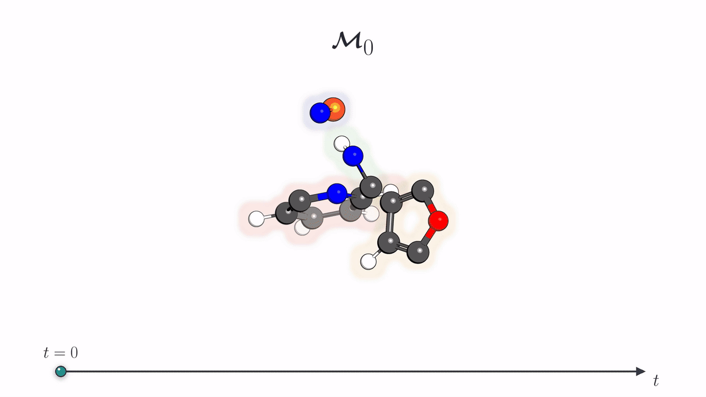
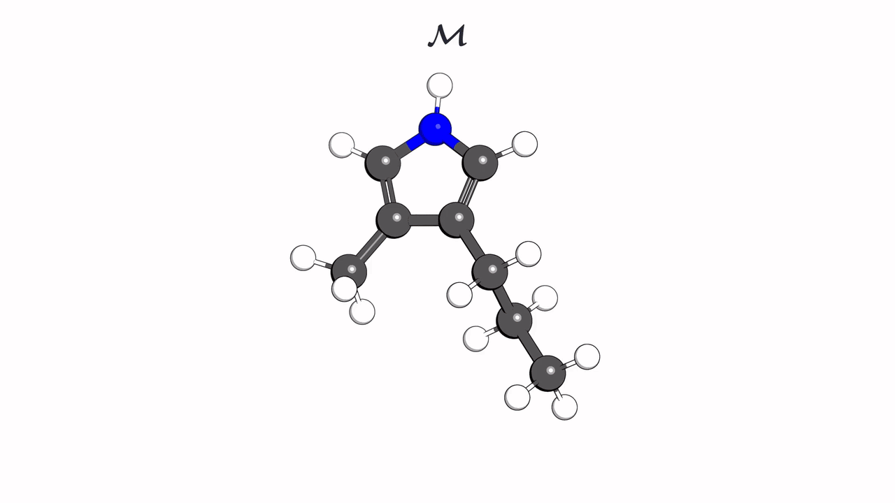

<h1 align="center">💊 MotiFlow 💊</h1>

<div align="center">

**3D molecule generation of drug-like molecules from rigid-body motifs via joint categorical and** $\mathrm{SE}(3)$ **flows**

</div>

---

<p align="center">
  <a href="https://arxiv.org/abs/2601.16955"></a>
  <a href="https://openreview.net/forum?id=10JJ9uxd6J"></a>
  <a href="https://pytorch.org/"></a>
  <a href="https://developer.nvidia.com/cuda-toolkit"></a>
</p>

<p align="center">
  
</p>

<p align="center"><em>✨ MotiFlow jointly generates rigid-motif identities and their poses, then reconstructs the resulting molecule at atom level. In this example, discrete FM uses a uniform prior.</em></p>

> **📄 Paper:** **3D Molecule Generation from Rigid Motifs via** $\mathrm{SE}(3)$ **Flows**
>
> **👥 Authors:** [Roman Poletukhin](https://rpoletukhin.github.io/) · [Marcel Kollovieh](https://marcelkollovieh.com/) · [Eike Eberhard](https://eseberhard.github.io/index.html) · [Stephan Günnemann](https://www.cs.cit.tum.de/daml/startseite/)
>
> **🏛️ Affiliations:**<br>
> [Technical University of Munich](https://www.tum.de/en/) · [Munich Center for Machine Learning](https://mcml.ai/)<br>
> [Munich Data Science Institute](https://www.mdsi.tum.de/en/mdsi/home/) · [Imperial College London](https://www.imperial.ac.uk/)

This repository is the **official implementation** of [*3D Molecule Generation from Rigid Motifs via*](https://arxiv.org/abs/2601.16955) $\mathrm{SE}(3)$ [*Flows*](https://arxiv.org/abs/2601.16955), accepted as a poster at [**NeurIPS 2026**](https://openreview.net/forum?id=10JJ9uxd6J). An earlier version was presented at the [ICML 2026 Workshop on Generative and Agentic AI for Biology (GenBio)](https://openreview.net/forum?id=7Ncv8Pt7rS).

---

## 🗺️ Table of Contents

- [🔬 Overview](#overview)
- [🗂️ Repository Layout](#repository-layout)
- [⚙️ Installation](#installation)
- [🧩 Data Preparation](#data-preparation)
- [🚀 Training](#training)
- [✨ Sampling and Evaluation](#sampling-and-evaluation)
- [🧪 Experiments and Ablations](#experiments-and-ablations)
- [📚 Citation](#citation)
- [🙏 Acknowledgements](#acknowledgements)
- [📄 License](#license)

<a id="overview"></a>

## 🔬 Overview

Most 3D molecular generators operate directly on atom types and Cartesian coordinates. MotiFlow instead represents a molecule as a set of **reusable rigid motifs**. Each motif is described by a **discrete class** and a **rigid pose** in $\mathrm{SE}(3)$, allowing the model to generate larger chemically meaningful building blocks rather than moving every atom independently.

For a molecule with $K$ motifs, MotiFlow factorizes the conditional probability path over motif identities $m_t^k$ and rigid transformations $\mathbf{T}_t^k$ as

```math
p_t\!\left(\boldsymbol{\mathcal{M}}_t \mid \boldsymbol{\mathcal{M}}_1\right) := \prod_{k=1}^{K} \underbrace{p_t\!\left(m_t^k \mid m_1^k\right)}_{\text{Discrete flow}} \underbrace{p_t\!\left(\mathbf{T}_t^k \mid \mathbf{T}_1^k\right)}_{\mathrm{SE}(3)\text{ flow}} .
```

The two coupled flows jointly generate **what each motif is** and **where it is placed** in three-dimensional space.

MotiFlow combines:

- **A data-driven rigid-motif vocabulary** that preserves frequent planar rings and ring systems while recursively decomposing rare structures into representable finer motifs.
- **Joint multimodal flow matching** over categorical motif identities, translations in $\mathbb{R}^3$, and rotations in $\mathrm{SO}(3)$.
- **Symmetry-aware geometric supervision** for motif classes with equivalent rigid-frame realizations.
- **Atom-level reconstruction without a learned decoder**, using the generated motif classes and poses together with dataset-specific bond perception.

The implementation supports unconditional generation on QM9 and GEOM-Drugs, composition- and substructure-conditional generation on QM9, fragmentation ablations on GEOM-Drugs and QMugs, architectural ablations, modality schedules, and wall-clock sampling benchmarks.

<a id="repository-layout"></a>

## 🗂️ Repository Layout

```text
MotiFlow/
├── assets/                     # README animations
├── configs/                    # Hydra configurations
│   ├── dataset/                # Raw and aligned dataset definitions
│   ├── fragmented_data/        # Fragmented-artifact profiles
│   ├── experiment/             # Paper experiments and ablations
│   ├── flow/                   # Categorical and SE(3) flow settings
│   ├── model/                  # IPA architecture
│   ├── loss/                   # Joint training objective
│   └── temperature/            # Sampling-temperature schedules
├── motiflow/
│   ├── analysis/               # Fragment and vocabulary statistics
│   ├── chem/                   # Atom reconstruction and bond perception
│   ├── data/                   # Loading, alignment, conditioning, batching
│   ├── evaluation/             # Molecular metrics and evaluation runner
│   ├── fragmentation/          # Vocabulary mining and decomposition
│   ├── models/                 # Categorical, R^3, SO(3), SE(3), and IPA models
│   ├── training/               # Losses, checkpoints, tracking, training
│   ├── utils/                  # Rigid-body and manifold utilities
│   └── visualization/          # Fragmentation visualization helpers
├── notebooks/                  # Artifact-inspection notebook
├── scripts/
│   ├── data_prep/              # Dataset preparation entry points
│   ├── train.py
│   ├── sample.py
│   ├── evaluate.py
│   ├── analyze_fragments.py
│   └── benchmark_walltime.py
├── environment.yml
└── pyproject.toml
```

<a id="installation"></a>

## ⚙️ Installation

The recommended environment is defined in [`environment.yml`](environment.yml). It installs Python 3.10, CUDA-enabled PyTorch 2.1, OpenBabel, RDKit, PyTorch Geometric, Hydra, WandB, and the notebook dependencies.

### Micromamba

To keep the environment on a high-capacity filesystem while retaining the short activation command `micromamba activate motiflow-env`, choose the desired micromamba root explicitly:

```bash
export MOTIFLOW_MAMBA_ROOT="/ceph/hdd/students/${USER}/micromamba"

micromamba shell init \
  --shell bash \
  --root-prefix "${MOTIFLOW_MAMBA_ROOT}"
source ~/.bashrc

micromamba create \
  --root-prefix "${MOTIFLOW_MAMBA_ROOT}" \
  --name motiflow-env \
  --file environment.yml

micromamba activate motiflow-env
```

Optionally register the environment as a Jupyter kernel:

```bash
python -m ipykernel install --user \
  --name motiflow-env \
  --display-name "MotiFlow (motiflow-env)"
```

Update an existing environment after dependency changes with:

```bash
micromamba env update \
  --root-prefix "${MOTIFLOW_MAMBA_ROOT}" \
  --name motiflow-env \
  --file environment.yml
```

Verify the installation:

```bash
python -c "import hydra, openbabel, rdkit, torch, torch_geometric, wandb; print(torch.__version__, torch.cuda.is_available())"
```

OpenBabel is installed through Conda because its Python bindings are not reliably buildable from PyPI.

<a id="data-preparation"></a>

## 🧩 Data Preparation

<p align="center">
  
</p>

<p align="center"><em>🧩 Molecules are decomposed into a frequency-aware hierarchy of rigid ring systems, rings, bonds, and anchored atom motifs.</em></p>

MotiFlow supports QM9, GEOM-Drugs, and QMugs. Only the QMugs split is introduced by this work; QM9 and GEOM-Drugs reuse established public splits.

| Dataset | Source and split | MotiFlow processing |
| --- | --- | --- |
| **QM9** | Raw structures and exact split from [equivariant-neural-diffusion](https://github.com/frcnt/equivariant-neural-diffusion) | Canonical-RDKit atom alignment and rigid-motif fragmentation |
| **GEOM-Drugs** | Preprocessed conformers and split from [GeoDiff](https://github.com/MinkaiXu/GeoDiff) | Canonical-RDKit atom alignment and rigid-motif fragmentation |
| **QMugs** | Raw data from the [official ETH release](https://libdrive.ethz.ch/index.php/s/X5vOBNSITAG5vzM) | Reproducible molecule-disjoint split, alignment, and fragmentation |

All paths below are relative to the repository root unless stated otherwise.

### QM9

Download the raw QM9 archive and the split published by equivariant-neural-diffusion:

```bash
mkdir -p data/qm9

wget -c \
  https://ndownloader.figshare.com/files/3195389 \
  -O data/qm9/dsgdb9nsd.xyz.tar.bz2

curl -fL \
  https://raw.githubusercontent.com/frcnt/equivariant-neural-diffusion/main/data/qm9/splits.json \
  -o data/qm9/splits.json
```

Expected layout:

```text
data/qm9/
├── dsgdb9nsd.xyz.tar.bz2
└── splits.json
```

The split contains 100,000 training, 17,748 validation, and 13,083 test molecule indices. MotiFlow verifies this upstream split and never generates a replacement.

### GEOM-Drugs

Download the preprocessed GEOM-Drugs artifacts from the [GeoDiff Google Drive folder](https://drive.google.com/drive/folders/1b0kNBtck9VNrLRZxg6mckyVUpJA5rBHh) and place the following files without renaming them:

```text
data/geom_drugs/
├── train_data_40k.pkl
└── val_data_5k.pkl
```

Verify their record counts, sizes, and SHA-256 hashes before preprocessing:

```bash
python scripts/data_prep/verify_geom_splits.py --data-root .
```

The aligned artifacts retain 197,220 of 199,950 training conformers and 24,676 of 25,000 validation conformers. Excluded samples fail deterministic source-topology/canonical-SMILES consistency checks; their identifiers and failure reasons are recorded in the generated manifests.

### QMugs

MotiFlow requires `summary.csv` and `structures.tar.gz` from the official QMugs release. The vibrational spectra, wavefunctions, and `tarball_assignment.csv` are not used.

```bash
export MOTIFLOW_QMUGS_ROOT=/absolute/path/to/qmugs
mkdir -p "${MOTIFLOW_QMUGS_ROOT}"

wget -c \
  'https://libdrive.ethz.ch/index.php/s/X5vOBNSITAG5vzM/download?path=%2F&files=summary.csv' \
  -O "${MOTIFLOW_QMUGS_ROOT}/summary.csv"

wget -c \
  'https://libdrive.ethz.ch/index.php/s/X5vOBNSITAG5vzM/download?path=%2F&files=structures.tar.gz' \
  -O "${MOTIFLOW_QMUGS_ROOT}/structures.tar.gz"

tar -xzf "${MOTIFLOW_QMUGS_ROOT}/structures.tar.gz" \
  -C "${MOTIFLOW_QMUGS_ROOT}"
```

Expected layout:

```text
$MOTIFLOW_QMUGS_ROOT/
├── summary.csv
└── structures/
    ├── CHEMBL1/
    │   ├── conf_00.sdf
    │   └── ...
    └── ...
```

Create and verify the molecule-disjoint, molecular-weight-stratified split used in the paper:

```bash
python scripts/data_prep/create_qmugs_splits.py \
  --summary-csv "${MOTIFLOW_QMUGS_ROOT}/summary.csv" \
  --output-dir "${MOTIFLOW_QMUGS_ROOT}/splits" \
  --verify-paper-manifest \
  --verify-source-sha256
```

All conformers belonging to the same ChEMBL molecule remain in the same split.

### Alignment and rigid-body fragmentation

Align each dataset to canonical RDKit atom order:

```bash
python scripts/data_prep/align.py dataset=qm9
python scripts/data_prep/align.py dataset=geom
python scripts/data_prep/align.py dataset=qmugs
```

Mine the default frequency-aware vocabulary and create model-ready rigid-motif representations:

```bash
python scripts/data_prep/fragment.py dataset=qm9 alpha_threshold=0.1
python scripts/data_prep/fragment.py dataset=geom alpha_threshold=0.1
python scripts/data_prep/fragment.py dataset=qmugs alpha_threshold=0.1
```

Generated artifacts are stored under:

```text
data/fragmented/<dataset>/alpha_<value>/
```

Each directory contains the vocabulary, geometric fragment library, sharded train/validation/test representations, reconstruction metrics, failure records, and a reproducibility manifest. The validation and test splits use the frozen training vocabulary; unseen coarse fragments fall back recursively to finer classes, and a molecule is skipped only when an irreducible class is absent from the training library.

After fragmentation, MotiFlow reconstructs every retained ground-truth molecule from its motif classes and poses and reports the same stability, validity, connectivity, and uniqueness metrics used for generated samples.

Inspect completed artifacts interactively with:

```bash
jupyter lab notebooks/inspect_fragmentation.ipynb
```

<a id="training"></a>

## 🚀 Training

Experiments are configured with Hydra. The default command launches unconditional QM9 training and logs to online WandB:

```bash
python scripts/train.py experiment=unconditional/qm9
```

Core paper configurations include:

```bash
# Unconditional generation
python scripts/train.py experiment=unconditional/qm9
python scripts/train.py experiment=unconditional/geom

# Conditional QM9 generation
python scripts/train.py experiment=conditional/qm9_composition
python scripts/train.py experiment=conditional/qm9_substructure

# Fragmentation ablations
python scripts/train.py experiment=ablations/fragmentation/geom/alpha_01
python scripts/train.py experiment=ablations/fragmentation/qmugs/alpha_01

# Architectural ablations
python scripts/train.py experiment=ablations/architecture/qm9/no_triangle_update
python scripts/train.py experiment=ablations/architecture/qm9/no_self_conditioning
```

Every scientific and runtime parameter can be overridden from the command line:

```bash
python scripts/train.py \
  experiment=unconditional/qm9 \
  training.batch_size=128 \
  training.max_steps=10000
```

WandB is enabled in online mode by default. Disable it or switch to offline logging with:

```bash
python scripts/train.py experiment=unconditional/qm9 tracking=disabled
python scripts/train.py experiment=unconditional/qm9 tracking.mode=offline
```

Authenticate with `wandb login` or `WANDB_API_KEY`. API keys should never be stored in configuration files.

<a id="sampling-and-evaluation"></a>

## ✨ Sampling and Evaluation

Sample from a checkpoint using the matching experiment profile:

```bash
python scripts/sample.py \
  experiment=unconditional/qm9 \
  sampling.checkpoint_path=/path/to/checkpoint.pth \
  sampling.num_steps=100 \
  temperature=linear_1_5_to_1 \
  sampling.num_samples=1024
```

Composition- and substructure-conditional runs use their corresponding experiment profiles and require `sampling.condition_path`.

Evaluate one or more generated sample files:

```bash
python scripts/evaluate.py \
  evaluation=qm9 \
  'evaluation.generated_paths=[outputs/samples/generated.pt]'
```

Use `evaluation=geom` or `evaluation=qmugs` for the OpenBabel-based bond-perception protocol. Evaluation reports atom stability, molecular stability, validity, connectivity, uniqueness, novelty, and their combined metrics.

<a id="experiments-and-ablations"></a>

## 🧪 Experiments and Ablations

The configuration tree mirrors the experiments reported in the paper:

```text
configs/experiment/
├── unconditional/
│   ├── qm9.yaml
│   └── geom.yaml
├── conditional/
│   ├── qm9_composition.yaml
│   └── qm9_substructure.yaml
└── ablations/
    ├── architecture/qm9/
    ├── fragmentation/geom/
    ├── fragmentation/qmugs/
    └── modality_schedule/geom/
```

Fragmentation and vocabulary statistics:

```bash
python scripts/analyze_fragments.py \
  fragmented_data@data=geom_rings_alpha_01 \
  analysis=geom
```

Wall-clock sampling benchmark:

```bash
python scripts/benchmark_walltime.py \
  benchmark.checkpoint_path=/path/to/qm9_checkpoint.pth \
  benchmark.num_steps=100

python scripts/benchmark_walltime.py \
  --config-name benchmark_walltime_geom \
  benchmark.checkpoint_path=/path/to/geom_checkpoint.pth \
  benchmark.num_steps=100
```

<a id="citation"></a>

## 📚 Citation

If MotiFlow is useful in your research, please cite:

```bibtex
@inproceedings{
  poletukhin2026d,
  title     = {3D Molecule Generation from Rigid Motifs via $\mathrm{SE}(3)$ Flows},
  author    = {Roman Poletukhin and Marcel Kollovieh and Eike Eberhard and Stephan G{\"u}nnemann},
  booktitle = {The Fortieth Annual Conference on Neural Information Processing Systems},
  year      = {2026},
  url       = {https://openreview.net/forum?id=10JJ9uxd6J}
}
```

<a id="acknowledgements"></a>

## 🙏 Acknowledgements

MotiFlow builds on the great [FoldFlow](https://github.com/DreamFold/FoldFlow), as well as ideas and selected geometric utilities from [OpenFold](https://github.com/aqlaboratory/openfold), [FrameDiff](https://github.com/jasonkyuyim/se3_diffusion), and their upstream dependencies. We thank their authors for making their work publicly available.

Dataset preparation follows the public QM9 split from [equivariant-neural-diffusion](https://github.com/frcnt/equivariant-neural-diffusion) and the preprocessed GEOM-Drugs split from [GeoDiff](https://github.com/MinkaiXu/GeoDiff).

The style of this README.md was largely inspired by Danyal Rehman's [AutoBG](https://github.com/danyalrehman/autobg) repo.

<a id="license"></a>

## 📄 License

This repository is distributed under the terms in [`LICENSE`](LICENSE). MotiFlow contains adapted components descended from FoldFlow and FrameDiff; the relevant attribution and licensing information is recorded in [`NOTICE`](NOTICE).
